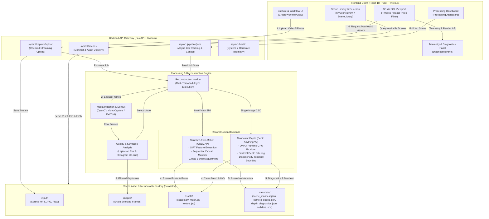
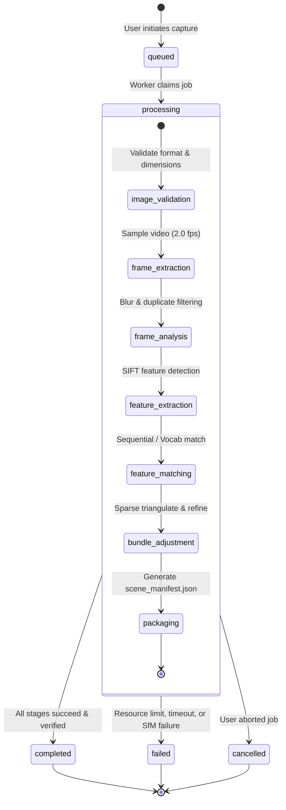

# SpatialForge — System Architecture

This document describes the end-to-end architecture, component relationships, data flow, and runtime boundaries of **SpatialForge**, an indoor 3D reconstruction and browser-based spatial exploration platform built for **Techfest Round 1: 3D Reconstruction & Roaming**.

---

## 1. High-Level Architecture Diagram

---

## 2. Processing Pipeline & State Machine

Every capture job follows an asynchronous lifecycle managed by `PipelineJobManager`:

### Job States:
- **`queued`**: Job metadata persisted to disk; waiting for reconstruction worker thread.
- **`processing`**: Background execution active. Sub-stages report granular progress:
  - `image_validation`: Verifies dimensions, MP limits, and format compatibility.
  - `frame_extraction` / `frame_analysis`: Decodes video and runs Laplacian variance blur rejection.
  - `depth_inference`: (Single-photo) Executes ONNX runtime inference.
  - `geometry_generation`: (Single-photo) Runs pinhole backprojection and topology boundary filtering.
  - `feature_extraction` / `matching` / `bundle_adjustment`: (COLMAP) Runs multi-view reconstruction.
  - `packaging`: Assembles `scene_manifest.json`, validates viewer bundle assets, and records checksums.
- **`completed`**: Viewer pack verified; scene ready for WebGL rendering.
- **`failed`**: Detailed diagnostic error logged without crashing the backend service.

---

## 3. Coordinate System & Transformations

SpatialForge maintains an explicit mathematical decoupling between **Reconstruction Source Space** and **Viewer World Space**:

1. **Viewer World Convention**:
   - Right-handed coordinate system.
   - $+Y$ points **Up** (world zenith).
   - $-Z$ points **Forward** (view direction into scene).
   - $+X$ points **Right**.
2. **Coordinate Matrix**:
   - Every `scene_manifest.json` specifies `coordinate_system.source_to_scene_matrix_row_major`.
   - The Three.js viewer wraps the primary visual assets in a top-level `<group matrix={sourceToScene} matrixAutoUpdate={false}>`, applying the transformation matrix directly to vertices on the GPU.

---

## 4. Architectural Boundaries & Security Guarantees

- **No Full Video Buffering**: Video streams are read frame-by-frame via OpenCV generators to ensure operation within 16 GB host RAM.
- **Path Traversal Protection**: Scene and asset API routes use strict path resolution checks. Paths containing `..` or targeting outside `datasets/` are blocked with HTTP 400/403.
- **Subprocess Isolation**: External binaries (COLMAP) run as isolated argument-list subprocesses with configured timeouts, per-stage log capture, and clean signal termination.
- **Progressive Asset Loading**: The viewer dynamically switches between GLTF/GLB models, PLY point clouds, and textured PLY meshes through a declarative renderer registry, applying React Suspense boundaries.
