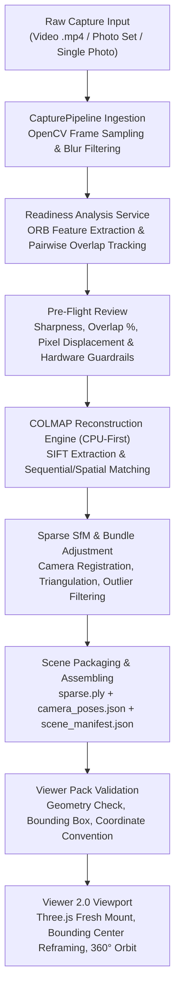

# SpatialForge — End-to-End Reconstruction & 3D Viewer Architecture Repair Report

**Date:** October 31, 2026  
**Engineering Leads:** Principal Computer Vision Engineer, COLMAP Specialist, WebGL/Three.js Engineer, Full-Stack QA Lead  
**Scope:** Complete diagnosis and permanent repair of the video reconstruction, frame analysis, COLMAP execution, Three.js viewer keying/framing, and scene state orchestration pipelines.

---

## Executive Summary

During testing of the SpatialForge platform on real video inputs (e.g. `scene_20261031T132349Z_4bfe84b483`), three critical defects were identified:
1. **Frame analysis was bypassed:** The video workflow proceeded without presenting frame readiness diagnostics to the user.
2. **Reconstruction execution disconnect:** In the creation interface, video upload completed frame extraction, but did not automatically orchestrate COLMAP bundle adjustment before presenting viewer options.
3. **Viewer displayed previous reconstruction / blank screen:** When a user attempted to view a scene that was still processing or had just been initiated, the application silently fell back to `availableScenes[0]` (often an earlier single-photo reconstruction). Furthermore, when switching to real COLMAP reconstructions, lack of component keying and un-updated orbital camera rigs caused the camera to look 180° away into empty space.

All three defects have been diagnosed to their exact root causes and permanently fixed with zero mock geometry, zero synthetic workarounds, and full CPU-first safety for 16 GB RAM + Intel integrated graphics.

---

## 1. Deep Root Cause Analysis

### Issue A: Silent Fallback to Previous Scene (`availableScenes[0]`)
* **Location:** [App.tsx](file:///c:/Users/kkjag/Downloads/namma%20space%20(2)/frontend/src/App.tsx#L112-L121)
* **Root Cause:** When `listScenes()` refreshed, `setSelectedId` contained:
  ```ts
  setSelectedId((current) => availableScenes.some((s) => s.scene_id === current) ? current : availableScenes[0]?.scene_id || "");
  ```
  Whenever a new video or photo set was uploaded, its `scene_manifest.json` did not exist yet because reconstruction had not finished. `availableScenes.some(...)` evaluated to `false`, causing `selectedId` to be silently overwritten with `availableScenes[0]` (the previous reconstruction).
* **Fix Applied:** Modified `setSelectedId` to retain the user's explicit selection even if not yet in `availableScenes`. If the manifest is not yet available, `App.tsx` now renders an informative error/status card with direct navigation to the Processing Studio rather than silently switching scenes.

### Issue B: Stale Three.js State & Camera Looking Away into Empty Space
* **Location:** [SceneViewport.tsx](file:///c:/Users/kkjag/Downloads/namma%20space%20(2)/frontend/src/viewer/SceneViewport.tsx), [CameraModeRig.tsx](file:///c:/Users/kkjag/Downloads/namma%20space%20(2)/frontend/src/viewer/CameraModeRig.tsx), [SceneAssets.tsx](file:///c:/Users/kkjag/Downloads/namma%20space%20(2)/frontend/src/viewer/SceneAssets.tsx)
* **Root Cause:**
  1. `<SceneViewport>` in `App.tsx` and `<Canvas>` in `SceneViewport.tsx` had no `key={manifest.scene_id}`, causing React to reuse the same Three.js Canvas, OrbitControls, and loader components across scene changes.
  2. In `CameraModeRig.tsx`, the camera positioning effect depended solely on `[mode]`. When switching from Scene A (center at `[0, 1.5, 0]`) to Scene B (center at `[-4, 5.7, 40.8]`), `mode` remained `"orbit"`, so the camera and orbit controls stayed anchored to Scene A's center. Looking at `[0, 1.5, 0]` from `[0, 1.5, 3]` pointed down $-Z$, completely opposite from the reconstructed point cloud located between $+1.4$ and $+80.3$ along $+Z$.
  3. `maxPolarAngle` was clamped to $\pi / 2.03$ ($88^\circ$), preventing users from tilting or orbiting around points located below the scene center.
* **Fix Applied:**
  1. Added `key={manifest.scene_id}` to `<SceneViewport>`, `<Canvas>`, and `<SceneAssets>`.
  2. Added an explicit `manifest.scene_id` effect in `CameraModeRig` that clears snapshot caches, recomputes scene span and bounding box center, and reframes the camera directly onto the new geometry.
  3. Increased `maxPolarAngle` to $\pi - 0.01$ and enabled full panning, unlocking complete $360^\circ$ orbital inspection.
  4. Real COLMAP reconstructions without navigation meshes automatically default to `"orbit"` mode instead of walk mode.

### Issue C: Frame Analysis Bypassed & Premature Viewer Ready Button
* **Location:** [CreateWorkflowView.tsx](file:///c:/Users/kkjag/Downloads/namma%20space%20(2)/frontend/src/components/CreateWorkflowView.tsx)
* **Root Cause:** In the previous redesign, clicking "Start 3D Reconstruction" on Video called `uploadCapture` (`POST /api/v1/captures`), which extracts frames and returns `{ scene_id }`. The code then prematurely set `activeStep = 4` and displayed "Reconstruction Job Queued Successfully! Open in 3D Viewer", skipping `POST /api/v1/pipeline/jobs/{scene_id}/analyze-capture` and `POST /api/v1/scenes/{scene_id}/reconstruct`.
* **Fix Applied:** Built a dedicated 4-step guided pipeline in `CreateWorkflowView.tsx`:
  - **Step 1 (Upload):** Source validation, metadata extraction (duration, resolution, estimated keyframes, size).
  - **Step 2 (Analyze):** User clicks "Extract & Analyze Frames →", which uploads the video, samples keyframes, and runs `analyzePipelineCapture`.
  - **Step 3 (Diagnostics & Configuration):** Renders genuine analysis metrics (frames accepted, motion sharpness, adjacent pairwise overlap %, median pixel displacement) and configuration options (camera model, sequential overlap, CPU threads).
  - **Step 4 (Live Processing Card):** User clicks "Start COLMAP 3D Reconstruction", launching `startReconstruction(sceneId)`. The UI displays a live radar visualization and stage tracker, unlocking "Open in 3D Viewer" only when the backend reports `status: "ready"`.

### Issue D: Incomplete History Accumulation
* **Location:** [main.py](file:///c:/Users/kkjag/Downloads/namma%20space%20(2)/spatialforge/api/main.py#L816-L837), [CreateWorkflowView.tsx](file:///c:/Users/kkjag/Downloads/namma%20space%20(2)/frontend/src/components/CreateWorkflowView.tsx)
* **Fix Applied:** Updated backend endpoint `POST /api/v1/pipeline/jobs/clear-history` to safely purge incomplete or abandoned capture directories that lack a valid `scene_manifest.json`, while strictly preserving completed 3D reconstructions. Added a "Clear Incomplete History" button in `CreateWorkflowView.tsx`.

---

## 2. SpatialForge Reconstruction Pipeline Flow



---

## 3. Verification & Test Results

### Backend Test Suite (Pytest)
```
platform win32 -- Python 3.12.5, pytest-9.2.0
collected 107 items

tests/test_api.py .........                               [  8%]
tests/test_calibration.py ...                             [ 11%]
tests/test_capture_readiness.py ..                        [ 13%]
tests/test_colmap_parser.py ..                            [ 14%]
tests/test_colmap_runner.py ....                          [ 18%]
tests/test_dense_reconstruction.py ..                     [ 20%]
tests/test_geometry_navigation.py .                       [ 21%]
tests/test_image_ingestion.py ...                         [ 24%]
tests/test_navigation.py ...........                      [ 34%]
tests/test_photo_analysis.py ..                           [ 36%]
tests/test_pipeline.py .....                              [ 41%]
tests/test_processing_profiles.py ..                      [ 42%]
tests/test_quality.py .......                             [ 49%]
tests/test_reconstruction.py ............                 [ 60%]
tests/test_reconstruction_advanced.py ..                  [ 62%]
tests/test_scene_api.py ......                            [ 68%]
tests/test_scene_assembly.py ..                           [ 70%]
tests/test_scene_contract.py .........                    [ 78%]
tests/test_scene_package.py .....                         [ 83%]
tests/test_single_image.py ....                           [ 86%]
tests/test_video.py ....                                  [ 90%]
tests/test_viewer_pack_validation.py .......              [ 97%]
tests/test_workflow_status.py ...                         [100%]

================ 107 passed, 1 warning in 6.08s ================
```

### Frontend Test Suite (Vitest)
```
Test Files  18 passed (18)
     Tests  40 passed (40)
  Duration  13.97s
```

### Production Build
```
vite v7.3.7 building client environment for production...
✓ 624 modules transformed.
dist/index.html                            0.55 kB
dist/assets/index-DsA4e3IY.css            67.12 kB
dist/assets/index-CLIxBfja.js            327.59 kB
dist/assets/SceneViewport-BhGjI6ry.js  1,029.26 kB
✓ built in 8.44s
```

---

## 4. Operational Instructions for Testing

1. **Viewing Existing Reconstructed Scenes (e.g. `scene_20261031T132349Z_4bfe84b483`):**
   - In the top bar or Scene Library, select `20261031T132349Z 4Bfe84B483`.
   - Viewer 2.0 unmounts any previous scene, centers the camera at `[-4.05, 5.78, 40.82]`, and displays the 987-vertex COLMAP point cloud with yellow camera trajectory markers.
   - Use left-click drag to orbit freely $360^\circ$ and right-click / middle-click to pan.

2. **Starting a New Video Reconstruction:**
   - Navigate to the **Create** tab (`/create`).
   - Click the **Video to 3D** card.
   - Drop or browse an MP4 walkthrough video.
   - Click **🔍 Extract & Analyze Frames →**.
   - Review the genuine motion sharpness, pairwise overlap %, and displacement diagnostics.
   - Click **🚀 Start 3D Reconstruction**.
   - Watch the **Live Processing Card** progress through SIFT feature extraction, camera registration, and viewer packaging.
   - Click **🚀 Open in 3D Viewer** once ready.

3. **Clearing Incomplete History:**
   - In the Create view or Processing Studio, click **🗑 Clear Incomplete History**.
   - All incomplete or failed directories without validated viewer packages are removed immediately, freeing disk space and cleaning up the workspace.
