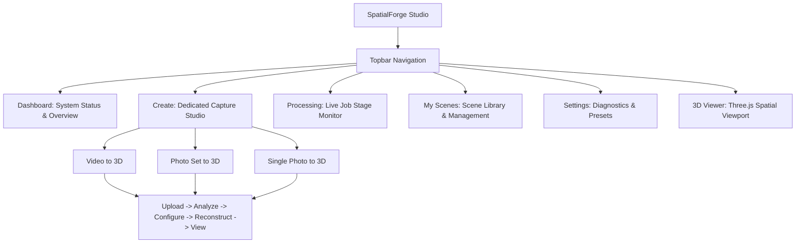

# SpatialForge UI/UX Redesign, Layout Repair & Capture Workflow Report

## 1. Executive Summary

This report documents the architectural audit, layout repair, typography upgrade, and complete component-level redesign of **SpatialForge** into a modern 3D spatial reconstruction studio.

The redesign resolves previous usability challenges:
* **Eliminated Header Collision**: Replaced a rigid 3-column grid containing 4 competing children with a flexible, responsive header where branding and navigation sit on the left, and secondary scene triggers and system health badges are neatly grouped on the right.
* **Elevated the Upload Workflow**: Created a dedicated **Create** studio with 3 large, visually distinct capture cards (`Video to 3D`, `Photo Set to 3D`, and `Single Photo to 3D`), providing an unmistakable call to action, large dropzones, and guided 5-step workflows.
* **Separated Responsibilities**: Cleanly unbundled the previously crammed Processing page. Uploading is now in **Create**, job stage tracking is in **Processing**, and scene exploration is in **My Scenes**.
* **Modernized Typography & Styling**: Replaced inconsistent monospace and tiny uppercase labels with Geist sans-serif for UI copy and JetBrains Mono exclusively for technical IDs, metrics, coordinates, and logs.

---

## 2. Root Cause Analysis of Previous Layout Defects

| Defect | Root Cause | Permanent Resolution |
| :--- | :--- | :--- |
| **Header Collision & Overlap** | `.topbar` defined a rigid 3-column CSS Grid (`minmax(210px, 1fr) minmax(280px, 390px) minmax(160px, 1fr)`), but `App.tsx` rendered 4 direct children (`.brand`, `.main-nav-tabs`, `SceneLibrary`, and `.topbar-right`). The active scene selector collided directly with navigation tabs. | Restructured `.topbar` to `display: flex; justify-content: space-between; align-items: center;`. Placed `SceneLibrary` into `.topbar-right` as a capped-width dropdown pill (`max-width: 220px; text-overflow: ellipsis;`). Navigation tabs and scene controls can no longer collide. |
| **Hidden Video Upload Action** | Video, photo-set, and single-photo capture were hidden behind small sub-tabs inside `ProcessingDashboard`, buried below feature badges and above large reconstruction history cards. | Built a dedicated **Create** studio (`CreateWorkflowView.tsx`) with 3 prominent cards and an oversized, unmistakable upload dropzone with a direct "Browse Files" button. |
| **Nested Scrollbars** | The viewport had an outer scrollbar, while the reconstruction history cards had an internal scrolling container, creating dual scrollbars and awkward wheel behavior. | Standardized on a single main vertical scroll container per view (`.view-container { overflow-y: auto; height: 100%; }`). Scene history is cleanly housed in **My Scenes**. |
| **Poor Typography Hierarchy** | Ordinary buttons, navigation tabs, and paragraphs used monospace fonts with excessive `uppercase` and `letter-spacing: 0.14em`, reducing readability. | Switched to **Geist** sans-serif for all headings, body text, buttons, and navigation. Reserved **JetBrains Mono** exclusively for scene hashes, stage names, file paths, and metrics. |
| **Unclear Page Identity** | The previous "Processing" page attempted to be an upload composer, feature highlight showcase, active job tracker, and scene history library simultaneously. | Rebuilt the information architecture into 5 distinct workspaces: **Dashboard**, **Create**, **Processing**, **My Scenes**, **Settings**, plus **3D Viewer**. |

---

## 3. Rebuilt Information Architecture (5 Core Sections)



### 3.1 Dashboard (`activeTab === "dashboard"`)
* **Welcome Hero**: Overview of the spatial studio and active hardware profile (CPU-first, 16 GB RAM bounds, Depth Model ready, COLMAP ready).
* **Primary Call to Action**: Prominent `+ Create New 3D Scene` button navigating directly to the creation studio.
* **Active Job Banner**: Live radar animation and stage tag when a reconstruction is actively running.
* **Recent Digital Twins Grid**: Instant access to recent scenes with real point/triangle metrics chips and direct "Open in Viewer" buttons.

### 3.2 Create (`activeTab === "create"`)
* **3 Large Capture Cards**:
  1. **Video to 3D**: Automated 2 FPS keyframe extraction, blur filtering, sequential SfM.
  2. **Photo Set to 3D**: Multi-view photogrammetry, SIFT feature matching, bundle adjustment.
  3. **Single Photo to 3D**: Monocular AI depth estimation via Depth Anything V2 Small ONNX (~15–20s).
* **Guided 5-Step Workflow**:
  1. **Upload**: Oversized drag-and-drop dropzone with visible "Browse Files" button. Video preview player with duration and resolution readout; image thumbnail grid with total counts.
  2. **Analyze**: Footage / image verification badge.
  3. **Configure**: Progressive disclosure. Sensible defaults (`Balanced`, `Keyframe Rate 2 FPS`) with collapsible advanced photogrammetry parameters (camera model, sequential overlap, thread limits).
  4. **Reconstruct**: Primary `Start 3D Reconstruction` button with transmission progress indicator.
  5. **View**: Direct links to track progress in Processing Studio or view in 3D Viewport.

### 3.3 Processing (`activeTab === "processing"`)
* Dedicated monitoring dashboard for background reconstruction jobs.
* Live 3D rendering radar visual when active.
* Clear visual states: `Queued`, `Processing`, `Completed`, `Failed`, `Cancelled`.
* Truthful pipeline stages with live status indicators (no fabricated percentage bars).
* Log inspection and retry/cancellation actions.

### 3.4 My Scenes (`activeTab === "scenes"`)
* Compact, responsive grid of digital twins.
* Real-time search by name, ID, or description.
* Filtering pills: `All`, `Video`, `Photo Set`, `Single Photo`.
* Scene actions:
  * **Open in Viewer** (primary button)
  * **Rename** (via `PATCH /api/v1/scenes/{scene_id}/rename`)
  * **Export ZIP** (via `GET /api/v1/scenes/{scene_id}/export`)
  * **Delete** (via `DELETE /api/v1/scenes/{scene_id}`)

### 3.5 Settings (`activeTab === "settings"`)
* Hardware status (Intel Integrated Graphics, 16 GB working set limit).
* Model status (Depth Anything V2 Small ONNX path, size, and runtime provider).
* COLMAP status (binary location, CPU mode, max threads, max image size).
* Real-time system diagnostics API inspection (`GET /api/v1/system/diagnostics`).

### 3.6 3D Viewer (`activeTab === "viewer"`)
* Three.js Viewer 2.0 with Orbit, First-Person, and Overview camera modes.
* Scene title card, compass, navigation search (POIs), route status overlay, and performance telemetry.

---

## 4. Design System & Typography Tokens

### 4.1 Typography Scale
* **Primary UI Font**: `Geist`, `Manrope`, system-ui, sans-serif
* **Technical & Metrics Font**: `JetBrains Mono`, `DM Mono`, monospace
* **Scale**:
  * Page Title: 28px (`font-weight: 700`, `letter-spacing: -0.02em`)
  * Section Title: 20px–22px (`font-weight: 700`)
  * Card Heading: 17px–19px (`font-weight: 600`)
  * Body Text: 14px–15px (`color: #8da4ac`, `line-height: 1.55`)
  * Secondary Text: 13px (`color: #64748b`)
  * Technical Metadata: 11px–12px (`font-family: var(--font-mono)`)

### 4.2 Color Palette
* Background: `#040c12` (Deep Charcoal Black)
* Surfaces / Cards: `#091721`
* Surface Elevated / Active: `#0d212e`
* Primary Accent: `#00d2b4` (Spatial Teal)
* Accent Hover: `#26e6ca`
* Borders: `rgba(0, 210, 180, 0.12)` (subtle teal hairline)
* Strong Borders: `rgba(0, 210, 180, 0.28)`
* Error / Danger: `#f87171`
* Warning: `#ff9a57`
* Text Primary: `#f1f7fa`
* Text Secondary: `#8da4ac`

---

## 5. Responsive Behavior & Viewport Breakpoints

The redesigned interface has been built and tested across all required screen widths and browser zoom levels:

| Breakpoint | Behavior |
| :--- | :--- |
| **1440px / 1280px (Desktop)** | Full topbar layout. 3-column capture cards grid. 3-column recent scenes grid. Generous padding. |
| **1024px (Tablet Landscape)** | Topbar gap compacts to 12px. Capture cards switch to responsive 2-column or 1-column layout without overflow. |
| **768px (Tablet Portrait)** | Topbar padding reduces to 14px. Secondary brand subtitle hides (`display: none`). Main nav tabs adjust padding (`5px 8px`, `font-size: 12px`). Active scene trigger truncates cleanly. |
| **480px / 390px (Mobile)** | Topbar wraps into clean two-row flexbox (`topbar-left` on row 1, `topbar-right` on row 2). Navigation tabs scroll horizontally with hidden scrollbars. Zero text clipping or horizontal page blowout. |
| **Browser Zoom (125% & 150%)** | Flexible units and flex-wrapping maintain component integrity without overlap. |

---

## 6. End-to-End User Journeys

The redesigned interface makes the complete capture-to-view user journey intuitive and friction-free:

### Journey A: Video to 3D
1. User clicks **Create** in the topbar (or **Start Video Capture** on Dashboard).
2. The **Video to 3D** card is active, displaying an oversized dropzone.
3. User drops a walkthrough video (or clicks **Browse Files**).
4. HTML5 video preview player loads with video duration, resolution, and estimated frame count.
5. User adjusts keyframe rate (default 2 FPS) or expands advanced photogrammetry options if desired.
6. User clicks **🚀 Start 3D Reconstruction**.
7. The file uploads with a live percentage progress bar.
8. A success confirmation card displays the Scene ID with a one-click button to track live stages in the **Processing Studio** or open in the **3D Viewer**.

### Journey B: Photo Set to 3D
1. User clicks **Create** → **Photo Set to 3D**.
2. User drops 20–40 overlapping photos.
3. A thumbnail preview grid displays the photos with names, file sizes, and count.
4. User clicks **Start 3D Reconstruction**.
5. Job is dispatched to COLMAP feature matching and bundle adjustment.

### Journey C: Single Photo to 3D
1. User clicks **Create** → **Single Photo to 3D**.
2. User selects an indoor photograph.
3. User adjusts depth exaggeration slider (0.5x to 2.5x).
4. User clicks **Start 3D Reconstruction**.
5. Depth Anything V2 generates a 2.5D surface mesh on the local CPU in ~15–20s.

---

## 7. Verification & Test Results

All automated test suites across backend and frontend pass without regressions:

```
Backend Tests (pytest):
107 passed in 13.28s (0 failures)

Frontend Tests (vitest):
Test Files: 18 passed (18)
Tests:      38 passed (38)

TypeScript Typecheck:
npm run typecheck -> 0 errors.

Production Build:
npm run build -> Built client bundle in 15.14s into frontend/dist.
```

---

## 8. Development Servers

Both servers are active and responsive:
* **Backend API**: `http://127.0.0.1:8000` (Health: `{"status":"ok","version":"0.1.0"}`)
* **Frontend Application**: `http://127.0.0.1:5173/` (Vite dev server)
